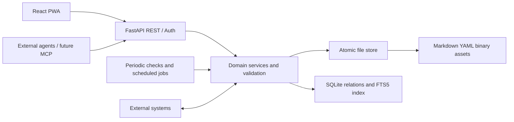

# Architecture Overview — Draft

## Architecture in one sentence

A single-user modular monolith exposing REST business operations to a React PWA, persisting user-owned content as
Markdown/YAML and binary files, and maintaining a rebuildable SQLite index for search, relationships and views.

## Logical components

### Principles

- One backend deployment initially; modules have bounded interfaces for capture, notes, tasks, relationships, indexing,
  privacy and integrations.
- All writes pass the same domain service regardless of whether initiated by UI or an authorized agent.
- Persistent content is written to files first as the source of truth. SQLite is derived and repairable.
- A failed index update must be detectable/recoverable; the application must not pretend file and index writes form a
  true cross-store atomic transaction.
- Consistency reconciliation runs periodically and on demand. No continuous file-system watcher required.
- Autosave uses debouncing and visible persistence status. Updates use conditional revision checks; conflicts resolved
  in UI.
- No real-time collaborative editor, no offline sync, no dynamic page builder.

## Storage and indexing

- UUID-named Markdown files with YAML frontmatter; fixed validated schemas and optional metadata.
- One canonical owner per relationship; reverse queries use SQLite index.
- A central `topics.yaml` for controlled topics and `attachments/manifest.yaml` for UUID ↔ original filename mapping
  (consider per-asset metadata if concurrency warrants).
- FTS5 indexes allowed readable text/metadata. Never index private plaintext by accident.
- Rebuild/verify operation scans source files, validates IDs/references and recreates index. External edits can be
  picked up on a scheduled scan, not instantly.
- Writes should use temp files + fsync/atomic rename as appropriate, and account for race conditions around writes,
  scans and backups.

## API and concurrency

- REST/OpenAPI used by UI and future CLI/MCP adapters. Resource endpoints, filters, relationship edits, capture
  promotion, batch operations as needed.
- Strong input validation and object-level authorization; external-agent identities/scopes distinguish read/write
  permissions.
- Conditional updates with revision/ETag; stale update returns conflict details and _never silently overwrites_. UI
  should offer server version, local version and a way to merge/save.
- Long-lived browser drafts must not be lost after conflict errors; explicit handling of unsaved state.

## UI

- React + TypeScript + shadcn/ui; purpose-coded pages for Inbox, Task Tracker, planning, Knowledge Hub, leadership,
  Areas.
- Responsive PWA, online-only; mobile design is independent rather than forced desktop scaling.
- Rich text WYSIWYG with slash commands and Markdown shortcuts, stored as standard Markdown. Decide editor framework
  after round-trip tests.
- External links show favicons; attachments, Mermaid, draw.io preview supported at appropriate stages. `.drawio` stays
  editable with external tool.

## Hosting and identity

- Single Linux host; Docker Compose deploys static frontend, backend and cloudflared; background jobs can run within
  backend initially.
- Cloudflare Access + Tunnel protect a single canonical domain (including on LAN); backend validates Access JWT
  signature, audience, issuer and expiry. Ensure origin cannot be reached through an unauthorized bypass.
- No application-managed login accounts in first version. Extra unlocking of private data, encryption and agent
  delegation require dedicated threat modeling before implementation.
- Web Push and calendar/integration credentials require explicit scopes and secure secret storage.

## Development and delivery

- Private GitHub monorepo; single devcontainer with Python/uv and Node/npm. Run FastAPI and Vite as processes inside
  devcontainer for HMR and easy debugging.
- Docker Compose for production and integration tests, not a required nested development stack.
- CI (GitHub Actions): static checks, pytest, frontend component tests, Playwright E2E, image builds to GHCR.
- Deployment manual to selected pinned image versions; backups managed externally; test a safe data-format rollback
  strategy before production upgrades.

## Architecture decisions needing implementation spikes

1. Rich editor Markdown round-trip and slash commands, including link/favicon handling.
2. Markdown schema validation, migration and atomic write/index reconciliation.
3. Conflict UI and client-side draft retention on failed autosave.
4. Protected data encryption, index exposure and unlock/delegated-access lifecycle.
5. Reliable Web Push delivery on target iOS PWA.
6. draw.io preview rendering without exposing unsafe active content.
